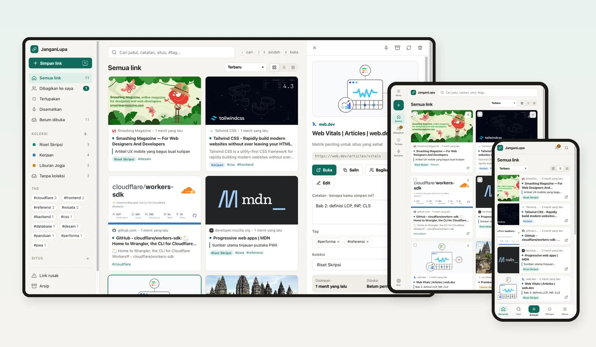

# JanganLupa

Simpan link dari HP atau laptop, beri catatan, dan temukan lagi kapan saja lewat pencarian. Link dan koleksi juga bisa dibagikan ke email orang lain.

---

## Fitur

- **Simpan cepat:** tempel (Ctrl/⌘+V) atau seret link di halaman mana pun, banyak link sekaligus, bookmarklet, dan menu Bagikan di Android.
- **Impor bookmark** dari browser (.html), JSON, atau teks.
- **Offline:** link diantre dan dikirim otomatis saat online.
- **Metadata otomatis:** judul, deskripsi, dan thumbnail dibaca dari halaman.
- **Catatan, tag, dan koleksi** berwarna, plus saran link yang masih berkaitan.
- **Deteksi duplikat** yang mengabaikan `www`, parameter pelacak, dan garis miring di akhir.
- **Pencarian full-text** di semua link dan koleksi.
- **Terlupakan:** link lama yang belum pernah dibuka, diacak setiap hari.
- **Pemeriksaan link rusak** dengan jalan pintas ke Wayback Machine.
- **Berbagi ke email** dengan akses lihat/edit, juga untuk penerima yang belum punya akun, serta link publik untuk koleksi.
- **Responsif:** tata letak desktop, tablet, dan HP, shortcut keyboard, dan mode gelap.
- **Login magic link** tanpa password, plus kode 6 digit.
- **Kelola akun:** daftar perangkat, ekspor HTML/JSON/CSV, dan hapus akun.

## Dokumentasi

| Dokumen | Isi |
|---|---|
| [Memulai](./docs/getting-started.md) | Menjalankan JanganLupa di komputer lokal |
| [Deploy ke Cloudflare](./docs/deployment.md) | Setup D1, Resend, secret, migrasi, dan custom domain di free tier |
| [Arsitektur](./docs/architecture.md) | Stack, struktur folder, model data, dan keputusan desain |
| [REST API](./docs/api.md) | Endpoint yang dipakai frontend |

## Berkontribusi

Pull request dan laporan bug sangat diterima. Baca [CONTRIBUTING.md](./CONTRIBUTING.md) dulu. Celah keamanan dilaporkan secara privat sesuai [SECURITY.md](./SECURITY.md).

## Lisensi

Dirilis di bawah [lisensi MIT](./LICENSE).

## Kontak

Dibuat oleh [@rizalahmaddd](https://github.com/rizalahmaddd). Butuh bantuan atau kustomisasi?

- WhatsApp: [+62 857-7777-5477](https://wa.me/6285777775477)
- Website: [solusikoding.com](https://solusikoding.com)
